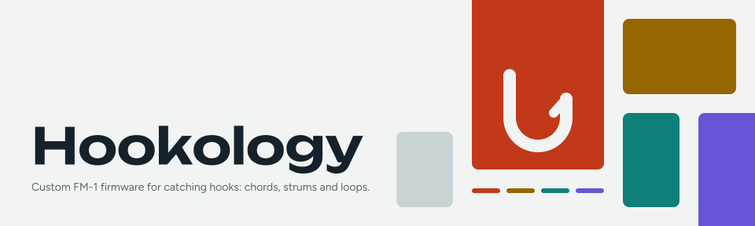

<picture>
  <source media="(prefers-color-scheme: dark)" srcset="docs/media/hookology-cover-dark.svg">
  
</picture>

**Custom firmware for the M-VAVE FM-1**, for catching an idea fast: as a chord, a strum, a loop or a hook.

Hookology is built on [Melodee](https://github.com/keremimo/melodee) 1.6.1 by Ellic Studio, which grew from
[Felucca](https://github.com/hugelton/Felucca) by Hügelton Instruments. It is not an official Melodee release, and it is
not made or endorsed by the Melodee, Felucca, SLOOP, HERA or ChoralRoot authors, or by M-VAVE.

## Install

1. Connect the FM-1 to your computer by USB.
2. Open the **[Hookology installer](https://bendawsonjr.github.io/hookology/)** in Chrome or Edge.
3. Press **Install**. Keep the USB cable connected until it says it is done.

The installer saves a complete backup first. To go back to the official firmware or to another custom
firmware, use the same installer's **Return to official V15** or **Back up and install TransitFM1**. If an
update is interrupted, see [boot protection](docs/BOOT-SAFETY.md) and
[recovery](BUILDING.md#recover-a-black-screen-fm-1).

Use at your own risk. Hookology has no Bluetooth (it is switched off in this build).

## What you get

- **Six sound tracks and two MIDI tracks**, with a TRACKS home page that shows every lane and a vertical MIXER.
- **Chords:** HERA's 100 chord sets, strums with SLOP and a two-octave RANGE, slash-chord names (C/E), flats or
  sharps, and twelve arp patterns.
- **Building a song:** a SECTIONS page (A to H), a song built from sections, Song mode and Loop song, and a free
  first take that sets the tempo and the loop length.
- **Effects:** shared REVERB, DELAY and more, plus up to three inserts per track (DRIVE, CRUSH, GATE, STUTTER and
  others).
- **Sounds:** Prophet, FM6 (DX7 patches), CZ-1, SID and six drum kits (808, 909, SID, CR78, FM and a sampled kit),
  with a Patches browser by category. You can pick a saved sound's category yourself.
- **A careful overload limit** that uses costs measured on a real FM-1, an ECO mode for heavy songs, and a
  battery reading on the GLO pages.
- **A new look:** the Stage and Daylight colour themes, Figtree type and the hook logo.
- **A web editor** in the same style, with a LIVE page for playing from the computer, a Song page, a piano roll,
  MIDI file import and export, and every track's sound as rows of knobs.

## Learn more

- **[The Hookology guide](docs/GUIDE.md):** making a song on the FM-1, step by step.
- **[HOOKOLOGY.md](HOOKOLOGY.md):** everything that differs from Melodee 1.6.1, version by version.
- **[Melodee's README](docs/MELODEE-README.md):** the reference for everything Hookology keeps from Melodee.
- **[BUILDING.md](BUILDING.md):** building the firmware yourself.

## Credits

Hookology stands on the work of many people. Thank you to:

- **Kerem Kilic (Ellic Studio)** for [Melodee](https://github.com/keremimo/melodee).
- **Leo Kuroshita (Hügelton Instruments)** for [Felucca](https://github.com/hugelton/Felucca).
- **isod89** for [SLOOP](https://github.com/isod89/sloop-fm1): its sections, free take, home screen, slicer, punch
  effects and web editor inspired or supplied parts of Hookology.
- **Ben Badio** for [HERA](https://github.com/benbadio/hera-fm1)'s chord sets.
- **Quixotic7 and the ChoralRoot contributors** for [ChoralRoot FM-1](https://github.com/Quixotic7/ChoralRootFM1):
  the boot protection and the arp patterns.
- The authors of Dexed and MSFA, reSID, DaisySP, Rings, the Figtree, Unbounded and Rubik fonts, the Fukiai icons
  and the VCSL samples.

The full list, with what came from where, is in [LICENSING.md](LICENSING.md).

## Licence

Hookology is free software under the [GNU General Public License v3.0 only](LICENSE). Some parts are under other
licences (MIT, Apache-2.0, BSD-3-Clause, MPL-2.0, SIL OFL 1.1, CC0); see [LICENSING.md](LICENSING.md) and
[LICENSES](LICENSES). M-VAVE and FM-1 are trademarks of their respective owners.
